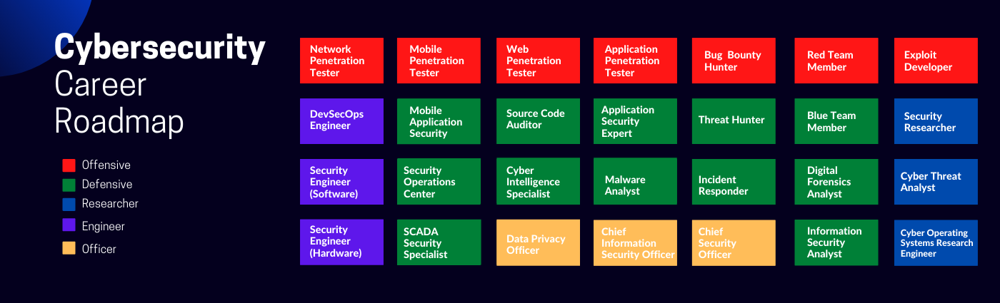

# Rutas de Carrera en Ciberseguridad

> **Traducción al español y actualización a datos de 2026** del repositorio [rezaduty/cybersecurity-career-path](https://github.com/rezaduty/cybersecurity-career-path).
> Los nombres de archivo se mantienen en inglés para facilitar la comparación con el repositorio original; el contenido está íntegramente en español.
>
> **Aviso de atribución**: este proyecto es una obra derivada. El contenido original y la imagen `allv1.png` pertenecen a **reza.duty** y se distribuyen bajo [MIT License](LICENSE) (© 2020 reza.duty), de acuerdo con los términos de esa licencia. Los archivos añadidos por esta traducción (ver [Cambios respecto al original](#cambios-respecto-al-original)) son contenido propio, también publicado bajo MIT.

⚠️ No incluye responsabilidades del puesto

⚠️ La educación y las certificaciones son **opcionales**: las certificaciones más valoradas en 2026 son OSCP (offensiva), CISSP/CISM (dirección) y las nativas de la nube (CCSP, AWS Security Specialty, CKS). Varias añaden entre un 10 % y un 35 % de prima salarial.

## Offensiva

* [Evaluador de Pruebas de Penetración de Redes](Network_Penetration_Tester.md)
* [Evaluador de Pruebas de Penetración Móvil](Mobile_Penetration_Tester.md)
* [Evaluador de Pruebas de Penetración Web](Web_Penetration_Tester.md)
* [Evaluador de Pruebas de Penetración de Aplicaciones](Application_Penetration_Tester.md)
* [Cazador de Recompensas por Bugs](Bug_Bounty_Hunter.md)
* [Miembro de Equipo Rojo](Red-Team-Member.md)
* [Desarrollador de Exploits](Exploit_Developer.md)

## Defensiva

* [Seguridad de Aplicaciones Móviles](Mobile_Application_Security.md)
* [Auditor de Código Fuente](Source_Code_Auditor.md)
* [Experto en Seguridad de Aplicaciones](Application_Security_Expert.md)
* [Cazador de Amenazas](Threat_Hunter.md)
* [Miembro del Equipo Azul](Blue-Team_Member.md)
* [Centro de Operaciones de Seguridad (SOC)](Security_Operation_Center.md)
* [Analista de Ciberamenazas](Cyber_Threat_Analyst.md)
* [Analista de Malware](Malware_Analyst.md)
* [Respondedor de Incidentes](Incident_Responder.md)
* [Analista Forense Digital](Digital_Forensic_Analyst.md)
* [Especialista en Seguridad SCADA/ICS](SCADA_Security_Specialist.md)
* [Analista de Seguridad de la Información](Information_Security_Analyst.md)

## Investigación

* [Investigador de Seguridad](Security_Researcher.md)
* [Analista de Ciberamenazas](Cyber_Threat_Analyst.md)
* [Ingeniero de Investigación de Sistemas de Operaciones Cibernéticas](Cyber_Operation_Systems_Research_Engineer.md)
* [Especialista en Inteligencia Cibernética](Cyber_Intelligence_Specialist.md)

## Ingeniería

* [Ingeniero DevSecOps](DevSecOps_Engineer.md)
* [Ingeniero de Seguridad (Software)](Security_Engineer(Software).md)
* [Ingeniero de Seguridad (Hardware)](Security_Engineer(Hardware).md)
* [Ingeniero de Automatización](Automation_Engineer.md)
* [Ingeniero de Seguridad de Redes](NetworkSecurity_Engineer.md)
* [Ingeniero de Seguridad en la Nube](CloudSecurity_Engineer.md)
* [Ingeniero de Seguridad de Datos](DataSecurity_Engineer.md)
* [Ingeniero de Detección](Detection_Engineer.md) _(archivo nuevo, no está en el original)_
* [Ingeniero de Flujos de Trabajo](Workflow_Engineer.md) _(archivo nuevo, no está en el original)_

## Dirección / Oficina

* [Delegado de Protección de Datos](Data_Privacy_Officer.md)
* [Chief Information Security Officer (CISO)](Chief_Information_Security_Officer.md)
* [Chief Security Officer (CSO)](Chief_Security_Officer.md)

## Créditos, licencia y atribución

- **Obra derivada de**: [rezaduty/cybersecurity-career-path](https://github.com/rezaduty/cybersecurity-career-path) (© 2020 reza.duty).
- **Licencia**: MIT — se incluye el aviso de copyright original en [LICENSE](LICENSE) tal y como exige la licencia para copias y porciones sustanciales.
- **Contenido original**: todos los perfiles de carrera, descripciones y la imagen `allv1.png` pertenecen a reza.duty.
- **Contenido añadido en esta traducción** (MIT): los archivos indicados como nuevos en [Cambios respecto al original](#cambios-respecto-al-original) y las actualizaciones de salarios, certificaciones y enlaces que señala esta guía.
- **Imagen**: `allv1.png` (el roadmap) es propiedad del repositorio original; si publicas este proyecto, consérvala o sustitúyela por una imagen propia.

## Cambios respecto al original

Este fork documenta de forma transparente todo lo que difiere del repositorio original para no atribuirse trabajo ajeno:

- **Traducción íntegra al español** de los archivos originales (Los nombres de archivo se conservan en inglés).
- **Salarios actualizados a 2026** con fuentes públicas: BLS, Glassdoor, PayScale, Robert Half, Indeed, ITJobsWatch y agregadores del sector. Rangos `P25 <= Mediana <= P75`. Aunque el original también mostraba salarios, sus cifras quedaron obsoletas.
- **Certificaciones**: los códigos de curso del original (p. ej., `SEC540`, `FOR578`) se reemplazaron por los nombres reales de las credenciales y se reflejó el cambio de abril de 2026 en el waiver de experiencia de CISSP (CEH/OSCP dejan de aplicarlo).
- **Herramientas y skills desactualizadas**: se actualizaron (Velociraptor, KAPE, Sigma, NetExec, CNAPP/CSPM, Zero Trust/SASE, IEC 62443, seguridad de IA/ML, etc.).
- **Enlaces rotos reparados**: los enlaces muertos (start.me, varios artículos de infosecinstitute, etc.) se sustituyeron por recursos vigentes (OWASP WSTG/MAS, PortSwigger Web Security Academy, SANS, Hack The Box, TryHackMe, CyberDefenders…).
- **Banner promocional eliminado**: el original contenía un anuncio de "Career Coach" (career.hadess.io) que no se ha reproducido en esta traducción.
- **Archivos recuperados**: `Cyber_Intelligence_Specialist.md` existe en el repositorio original pero no estaba enlazado en su README; aquí se incluye en la sección de Investigación.
- **Archivos nuevos (contenido propio, MIT)**: `Detection_Engineer.md` e `Workflow_Engineer.md`, que el repositorio original solo mencionaba en su `TODO` sin contenido asociado. Están marcados en el índice con su origen.

## Niveles de seniority más comunes

1. **Intern (Becario / Prácticas)**
    - Normalmente para estudiantes o recién titulados que consiguen su primera experiencia laboral.
2. **Junior**
    - Puestos de nivel inicial que requieren supervisión y orientación; suelen ser adecuados para quienes tienen poca experiencia.
3. **Mid-Level (Nivel medio)**
    - Profesionales con algunos años de experiencia que pueden trabajar de forma independiente y gestionar proyectos con cierta complejidad.
4. **Senior**
    - Profesionales con un alto nivel de conocimiento que pueden asesorar a otros y liderar proyectos.
5. **Lead**
    - Un rol que suele incluir responsabilidades de liderazgo, supervisando equipos o proyectos concretos.
6. **Staff**
    - Un rol técnico sénior que puede no tener responsabilidades directas de gestión, pero que implica una experiencia y una influencia significativas dentro de la organización.
7. **Principal**
    - Puesto muy sénior que suele ser responsable de definir la dirección técnica, tomar decisiones de arquitectura o influir en la estrategia empresarial.
8. **Architect (Arquitecto)**
    - Se centra en el diseño y la estructura de sistemas y soluciones, requiriendo una amplia experiencia y conocimiento.
9. **Manager**
    - Normalmente implica la supervisión de equipos o departamentos, priorizando la gestión de personal además de las habilidades técnicas.
10. **Director**
    - Rol de alta dirección responsable de la dirección estratégica y el liderazgo general de un departamento o función.
11. **Vicepresidente (VP)**
    - Posición de nivel ejecutivo, a menudo responsable de un área significativa de la organización (p. ej., ciberseguridad, tecnología).
12. **Nivel C (p. ej., CTO, CISO)**
    - Posiciones ejecutivas responsables de la estrategia y dirección general de la postura de tecnología o seguridad de la organización.

## Notas sobre los datos de 2026

- **Salarios**: rangos anuales aproximados (bruto) basados en informes de 2026 de BLS, Glassdoor, PayScale, Robert Half, Indeed y agregadores del sector (EE. UU., Europa, APAC, etc.). Se muestran como `P25 <= Mediana <= P75`. El salario depende de la experiencia, la industria, la ubicación y las certificaciones.
- **Certificaciones**: se incluyen las credenciales más demandadas en 2026. Desde abril de 2026, el waiver de experiencia de CISSP redujo su lista (CEH, CISA, CRISC y OSCP ya no califican para el waiver; Security+, CISM y CCSP sí).
- **Recursos de formación**: se han reemplazado los enlaces rotos por recursos vigentes (OWASP WSTG, PortSwigger Web Security Academy, Hack The Box, TryHackMe, SANS, etcétera).